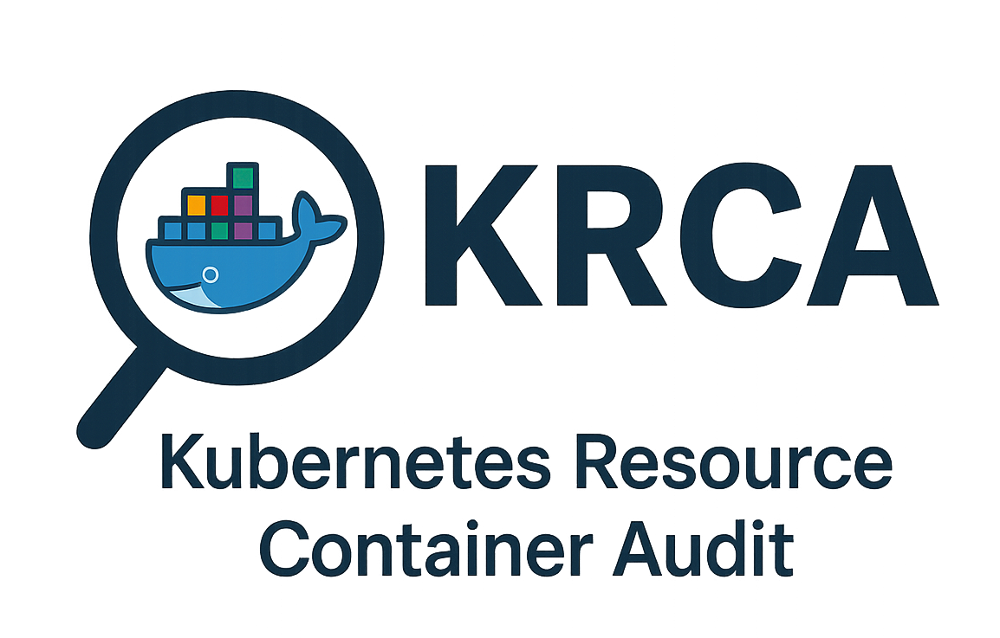
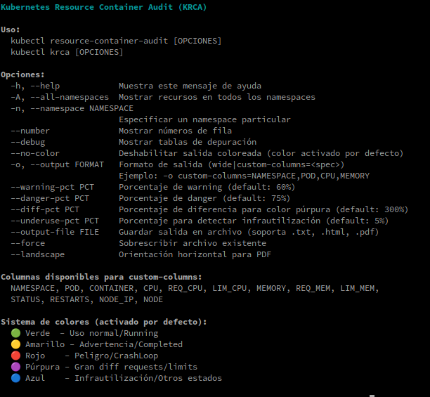
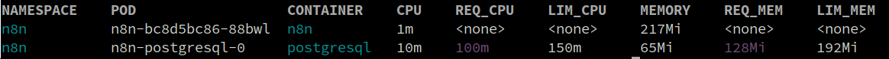

<div>
<p align="center">
  
</p>

<h1 align="center">🔍 KRCA - Kubernetes Resource Container Audit</h1>

<p align="center">
  <a href="https://pypi.org/project/krca/"></a>
  <a href="https://pypi.org/project/krca/"></a>
  <a href="./LICENSE"></a>
</p>

<p align="center">
  <strong>Monitor • Analyze • Optimize your Kubernetes resources</strong>
</p>
</div>


> Es un plugin de línea de comandos para `kubectl` que permite:   
>  **auditar el uso de CPU,  memoria, Request y Limits** en contenedores de Kubernetes/OpenShift,   
> destacando posibles problemas de configuración de recursos mediante un sistema de **colores visuales**.  


## 📝 ideal para detectar:
- Uso excesivo de CPU o memoria
- Configuraciones incorrectas o ausentes de `requests` o `limits`
- Contenedores infrautilizados o sobreasignados
- Estados de error o reinicios frecuentes
- **Picos históricos de consumo** (Prometheus) para dimensionar `requests` y `limits`

---

## 🏷️ Versión

La versión de KRCA se define en un único lugar: el archivo [`VERSION`](./VERSION).
El paquete Python, el instalador y la salida de `krca --version` leen ese valor,
por lo que no hace falta actualizarlo en varios archivos.

---

## 📥 Instalación  

### Opción 1: Homebrew (macOS / Linux)

```bash
brew install upszot/krca/krca
```

### Opción 2: PyPI (pip / pipx)

```bash
# Recomendado: entorno aislado
pipx install krca

# O dentro de un virtualenv
python3 -m venv ~/.venvs/krca && source ~/.venvs/krca/bin/activate
pip install krca
```

Ambos métodos instalan los comandos `krca` y `kubectl-krca`.

### Opción 3: instalador con `sudo`

Instalación rápida (requiere `sudo`):

```bash
curl -fsSL https://raw.githubusercontent.com/upszot/kubectl-resource-container-audit/master/install.sh | sudo bash
```

El instalador:

- Descarga el código de la rama indicada (por defecto `master`) en un solo archivo comprimido.
- Instala las dependencias Python en un **venv aislado** dentro del directorio de instalación, sin modificar los paquetes del sistema.
- Lee la versión desde `VERSION`, la copia junto a la instalación y verifica que el comando instalado reporte esa misma versión.
- Verifica la instalación y deja disponibles los comandos `krca` y `kubectl-krca`.
- Es idempotente: se puede volver a ejecutar para actualizar.

### Opciones del instalador

```bash
# Instalar la rama actual (v6.0)
curl -fsSL https://raw.githubusercontent.com/upszot/kubectl-resource-container-audit/v6.0/install.sh \
  | sudo bash -s -- --branch v6.0

# Instalar otra rama, tag o commit específico
curl -fsSL https://raw.githubusercontent.com/upszot/kubectl-resource-container-audit/master/install.sh \
  | sudo bash -s -- --branch <rama-o-tag>

# Instalar desde un checkout local (sin red)
sudo ./install.sh --source .

# Directorios personalizados
sudo ./install.sh --prefix /opt/krca --bin-dir /usr/local/bin

# Ver todas las opciones
./install.sh --help
```

### Desinstalación

```bash
curl -fsSL https://raw.githubusercontent.com/upszot/kubectl-resource-container-audit/master/uninstall.sh | sudo bash -s -- --yes
```

O desde el repositorio:

```bash
sudo ./uninstall.sh --yes
```

---

✅ Requisitos
 - Python 3.12+ (el instalador crea un venv e instala las dependencias de `requirements.txt`).
 - wkhtmltopdf (opcional, sólo para exportar a PDF)
 - kubectl configurado con acceso a un cluster válido
 - Acceso a permisos para listar pods y contenedores (kubectl get pods -A -o json)
 - [metrics-server](https://github.com/kubernetes-sigs/metrics-server) 
 - *(Opcional)* Prometheus / kube-prometheus-stack en el mismo cluster para el análisis histórico

---

🚀 Uso básico

```sh
kubectl krca --help
```


---

## 📈 Análisis histórico con Prometheus

Además del uso instantáneo (`kubectl top`), KRCA puede analizar el consumo
histórico de los contenedores consultando el **Prometheus** (kube-prometheus-stack)
que esté corriendo en el mismo cluster. Las columnas históricas se agregan a la
vista `-o wide`.

```sh
# Últimas 24 horas (ventana por defecto)
kubectl krca -n production -o wide --history

# Últimos 7 días en todos los namespaces
kubectl krca -A -o wide --history --history-window 7d

# Exportar el análisis semanal a HTML
kubectl krca -A -o wide --history --history-window 7d --output-file audit.html
```

Por defecto KRCA **descubre** el servicio de Prometheus y consulta su API a través
del **proxy del API server de Kubernetes**, reutilizando el kubeconfig y los
permisos del usuario actual. No necesita port-forward, ingress ni credenciales
adicionales.

Métricas utilizadas (cAdvisor):
`container_cpu_usage_seconds_total` y `container_memory_working_set_bytes`.

### Columnas históricas

| Columna | Contenido |
|---|---|
| `CPU_AVG` | Promedio de CPU de la ventana (milicores) |
| `CPU_P95` | Percentil 95 de CPU (milicores) |
| `CPU_MAX` | Pico de CPU (milicores) |
| `MEM_AVG` | Promedio de memoria de trabajo (MiB) |
| `MEM_MAX` | Pico de memoria de trabajo (MiB) |
| `SAMPLES` | Cantidad de muestras usadas en el cálculo |

### Colores en el modo histórico

Se aplican las mismas reglas que en la vista live, usando el **promedio** para
CPU y el **pico** para memoria:

| Color | Significado |
|---|---|
| 🔴 Rojo | Pico por encima del `limit` (riesgo de OOMKill) o uso por encima de `danger-pct` |
| 🟡 Amarillo | Uso por encima de `warning-pct`; `requests`/`limits` no definidos |
| 🟢 Verde | Uso normal entre `request` y `limit` |
| 🔵 Azul | Infrautilización severa (`< underuse-pct` del request) |
| 🟣 Púrpura | Uso por debajo del request o diferencia excesiva `limit/request > diff-pct` |

### Opciones

| Opción | Descripción | Default |
|---|---|---|
| `--history` | Activa las columnas históricas (requiere `-o wide`) | desactivado |
| `--history-window DUR` | Ventana a analizar (`30m`, `12h`, `7d`, `2w`) | `24h` |
| `--history-step DUR` | Paso de muestreo | automático (~300 puntos/serie) |
| `--prometheus-namespace NS` | Namespace del servicio de Prometheus | autodetección |
| `--prometheus-service NAME` | Servicio de Prometheus (acepta `ns/nombre`) | autodetección |
| `--prometheus-timeout SEC` | Timeout de la consulta | `60` |

También se pueden pedir columnas históricas con `-o custom-columns`, sin
necesidad de `-o wide`:

```sh
kubectl krca -n production -o custom-columns=POD,CONTAINER,CPU_AVG,MEM_MAX \
  --history --history-window 7d
```

### Permisos necesarios (RBAC)

KRCA consulta Prometheus a través del subrecurso `services/proxy` del API server:

```yaml
apiVersion: rbac.authorization.k8s.io/v1
kind: Role
metadata:
  name: krca-prometheus-proxy
  namespace: monitoring
rules:
  - apiGroups: [""]
    resources: ["services/proxy"]
    verbs: ["get"]
---
apiVersion: rbac.authorization.k8s.io/v1
kind: RoleBinding
metadata:
  name: krca-prometheus-proxy
  namespace: monitoring
subjects:
  - kind: User
    name: <su-usuario>
    apiGroup: rbac.authorization.k8s.io
roleRef:
  kind: Role
  name: krca-prometheus-proxy
  apiGroup: rbac.authorization.k8s.io
```

### Notas y limitaciones

- La ventana no puede superar la retención de Prometheus (en kube-prometheus-stack
  suele ser `10d`). Ajuste `--history-window` o la retención del stack.
- `CPU_P95`, `CPU_MAX` y `MEM_MAX` se calculan sobre el paso de muestreo. Para
  detectar picos muy cortos use un paso menor: `--history-step 1m`.
- Sólo se muestran los pods que existen en el momento de la auditoría; las series
  de pods eliminados se ignoran.
- Si Prometheus no está disponible o faltan permisos, KRCA muestra una advertencia
  por `stderr` y continúa con la vista live (columnas históricas en `-`).
- Compatible con Prometheus, kube-prometheus-stack y Thanos Querier
  (`--prometheus-service thanos-querier`).

---

🎨 Sistema de colores  
🔴 Rojo	Uso > danger-pct o uso > limit. Estado CrashLoopBackOff.   
🟡 Amarillo	Uso > warning-pct. Requests o limits no definidos. Terminated: Completed.   
🟢 Verde	Uso normal entre request y limit. Estado: Running.   
🔵 Azul	Infrautilización (< underuse-pct). Otros estados (Waiting, etc).   
🟣 Púrpura	Diferencia excesiva entre requests y limits.   

---

📊 Ejemplo de salida  
<div>
<table>
   <tr>
      <td></td>
   </tr>
</table>
</div>

---

## Estructura del proyecto  
```sh
kubectl-resource-container-audit/
│
├── VERSION                     # Versión actual (fuente única de verdad)
├── pyproject.toml              # Empaquetado para PyPI (Hatchling)
├── install.sh                  # Instalador
├── uninstall.sh                # Desinstalador
│
├── krca/                       # Paquete principal
│   ├── __init__.py             # Paquete y resolución de versión
│   ├── __main__.py             # Entry point de `krca` / `kubectl-krca`
│   ├── cli.py                  # Lógica de línea de comandos (argparse)
│   ├── core.py                 # Funcionalidades principales
│   ├── colorizer.py            # Lógica de colores y estilos
│   ├── kubectl.py              # Interacción con kubectl
│   ├── prometheus.py           # Cliente de Prometheus vía proxy del API server
│   ├── history.py              # Análisis histórico (avg/p95/max por contenedor)
│   ├── exporter.py             # Exportación (HTML/PDF/otros formatos)
│   ├── utils.py                # Funciones auxiliares
│   └── models.py               # Modelos de datos (si usas clases)
│
├── scripts/                    # Scripts ejecutables
│   └── krca                    # Punto de entrada para desarrollo (delega en krca.__main__)
│   └── krca-wrapper.sh         # Wrapper bash para instalación
│
├── packaging/                  # Archivos de distribución
│   └── homebrew/               # Fórmula y recursos del tap de Homebrew
│
├── output-test/                # Ejemplos de salida
│   ├── test.html
│   ├── test.pdf
│   ├── test.png
│   └── test.txt
│
└── requirements.txt            # Dependencias
```

---

🧑‍💻 Autor  
Desarrollado por @upszot para entornos Kubernetes y OpenShift.

## 👥 Colaboradores
- **@Miguel** - mi 2do tester :-D
- [RockD](https://github.com/RockD)

---

📄 Licencia
[GPL 3.0](./LICENSE)
